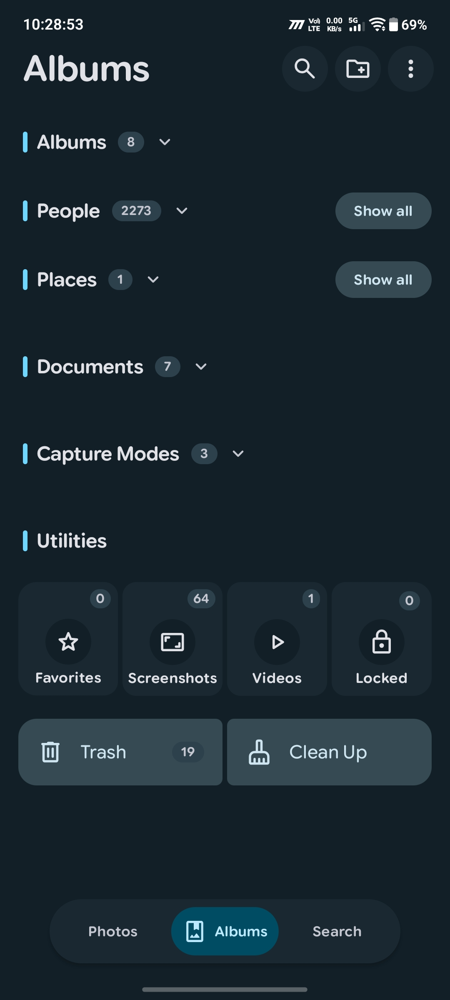
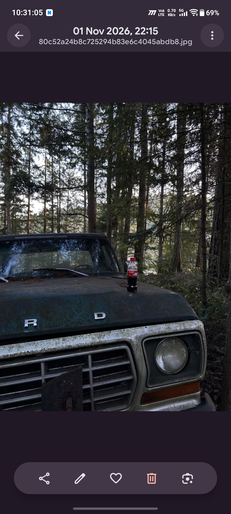
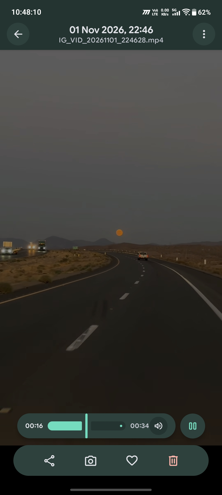

<div align="center">


# Photon Gallery

**A lightweight, 100% offline Android gallery crafted with Material 3 Expressive.**<br/>
*Fluid native timeline, on-device AI search, private vault, and complete local privacy.*

<br/>

[](https://github.com/Bn5prS/Photon_Gallery/stargazers)
[](https://github.com/Bn5prS/Photon_Gallery/releases)
[](https://developer.android.com/about/versions/12)
[](https://kotlinlang.org)
[](LICENSE)

<br/>

<p align="center">
  
  
  
  
  
</p>

<br/>

<a href="https://github.com/Bn5prS/Photon_Gallery/releases/latest">
  
</a>

<br/><br/>

</div>

---

### 📋 Quick Facts

<table width="100%">
<thead>
  <tr>
    <th align="left" width="25%">Property</th>
    <th align="left">Details</th>
  </tr>
</thead>
<tbody>
  <tr>
    <td><b>Platform</b></td>
    <td>Android 12 and above (API 31+ · Compiled for Android 37)</td>
  </tr>
  <tr>
    <td><b>License</b></td>
    <td>GNU General Public License v3.0 (GPLv3) with Section 7 Attribution</td>
  </tr>
  <tr>
    <td><b>Price & Privacy</b></td>
    <td>Free, 100% offline, zero ads, zero trackers, and zero telemetry</td>
  </tr>
  <tr>
    <td><b>Design Language</b></td>
    <td>Material 3 Expressive, Material You dynamic color, fluid spring physics, AMOLED true black</td>
  </tr>
  <tr>
    <td><b>On-Device AI</b></td>
    <td>MobileCLIP semantic search (ONNX Runtime) & on-device OCR (ML Kit) — runs 100% locally</td>
  </tr>
  <tr>
    <td><b>Architecture</b></td>
    <td>Jetpack Compose, Native High-Performance Timeline, Room (SQLite + FTS5), Coil 3</td>
  </tr>
</tbody>
</table>

---

### 📱 Quick Navigation

<div align="center">

| Action | Destination |
|:---|:---|
| 📦 **Download APK** | [GitHub Releases](https://github.com/Bn5prS/Photon_Gallery/releases/latest) |
| 🐛 **Bug Reports & Issues** | [GitHub Issue Tracker](https://github.com/Bn5prS/Photon_Gallery/issues) |
| 💡 **Feature Requests** | [GitHub Discussions / Issues](https://github.com/Bn5prS/Photon_Gallery/issues/new) |
| 📜 **License & Terms** | [GPL-3.0 License](LICENSE) |

</div>

---

### ✨ Screenshots

<div align="center">

| Home Timeline | Albums Grid | Full-Screen Viewer | Video Player |
|:---:|:---:|:---:|:---:|
|  |  |  |  |

| Multi-Select | Photo Editor | Stitch Tool | Settings |
|:---:|:---:|:---:|:---:|
|  |  |  |  |

</div>

---

### 🚀 Key Features

<table width="100%">
<thead>
  <tr>
    <th align="left" width="30%">Feature</th>
    <th align="left">Capabilities</th>
  </tr>
</thead>
<tbody>
  <tr>
    <td><b>⚡ Fluid Native Timeline</b></td>
    <td>Instantaneous flings and multi-density pinch-to-zoom powered by an in-memory native pipeline. Handles 50,000+ photos with 0ms stutter and smooth top bar auto-hide interop.</td>
  </tr>
  <tr>
    <td><b>🎨 Material 3 Expressive</b></td>
    <td>Fully adaptive UI following Material 3 Expressive design. Features spring physics, tonal elevations, shape-morphing cards, and automatic dynamic theme color palettes.</td>
  </tr>
  <tr>
    <td><b>🔒 Private Space (Vault)</b></td>
    <td>Biometric-locked (Fingerprint / Face Unlock / PIN) encrypted vault. Media inside the vault is completely hidden from system media scanners and other third-party apps.</td>
  </tr>
  <tr>
    <td><b>🔍 100% On-Device AI Search</b></td>
    <td>Natural-language semantic photo search using on-device MobileCLIP neural embeddings. Search by concepts like <i>"sunset over mountains"</i> or <i>"receipt with coffee"</i> with zero cloud requests.</td>
  </tr>
  <tr>
    <td><b>📝 Offline OCR Text Recognition</b></td>
    <td>Automatically recognizes text inside screenshots, signs, and documents directly on-device. Search for any word appearing anywhere inside your pictures.</td>
  </tr>
  <tr>
    <td><b>👥 Face Clustering & People</b></td>
    <td>Local on-device face detection and embedding extraction. Groups family and friends automatically with seamless merge and renaming tools.</td>
  </tr>
  <tr>
    <td><b>🗺️ Interactive Photo Map</b></td>
    <td>Geotagged exploration powered by osmdroid and OpenStreetMap. Browse your travels through clustered location markers with full offline tile support.</td>
  </tr>
  <tr>
    <td><b>✏️ Photo Editor & Markup</b></td>
    <td>Comprehensive creative suite with drawing tools (pen, highlighter, neon glow brush, blur redaction, shapes, interactive text), color grading presets, and crop/rotation adjustments.</td>
  </tr>
  <tr>
    <td><b>🧩 Long Screenshot Stitching</b></td>
    <td>Seamlessly stitch multiple images vertically or horizontally with smart aspect-ratio alignment and high-resolution export.</td>
  </tr>
  <tr>
    <td><b>🧹 Duplicate Cleaner & Recycle Bin</b></td>
    <td>Identifies duplicate and similar photos using perceptual hashing (pHash) with MD5 exact-match verification badges. Soft-delete trash bin with configurable auto-purge retention.</td>
  </tr>
</tbody>
</table>

---

### 🛠️ Tech Stack & Architecture

<table width="100%">
<thead>
  <tr>
    <th align="left" width="22%">Layer</th>
    <th align="left" width="38%">Library / Technology</th>
    <th align="left">Role</th>
  </tr>
</thead>
<tbody>
  <tr>
    <td><b>UI & Layout</b></td>
    <td>Jetpack Compose · Material 3 Expressive · Compose Navigation</td>
    <td>Modern declarative UI, spring transitions, and shared element animations.</td>
  </tr>
  <tr>
    <td><b>Timeline Grid</b></td>
    <td>Native AndroidView · RecyclerView · NestedScrolling Interop</td>
    <td>Zero-overhead 60/120fps scrolling with frictionless multi-column pinch gestures.</td>
  </tr>
  <tr>
    <td><b>Database</b></td>
    <td>Room 2.6 · SQLite · FTS5 Full-Text Search</td>
    <td>High-speed indexed metadata caching and sub-millisecond local text queries.</td>
  </tr>
  <tr>
    <td><b>Image Loading</b></td>
    <td>Coil 3 (Kotlin Multiplatform engine)</td>
    <td>High-efficiency multi-tier disk and memory LRU caching for WebP, HEIF, SVG, and GIF.</td>
  </tr>
  <tr>
    <td><b>Local AI & ML</b></td>
    <td>ONNX Runtime · MobileCLIP · ML Kit OCR</td>
    <td>100% on-device neural embeddings and offline character recognition.</td>
  </tr>
  <tr>
    <td><b>Media & Video</b></td>
    <td>AndroidX Media3 ExoPlayer</td>
    <td>Hardware-accelerated playback with pinch-to-zoom, playback speed, and loop modes.</td>
  </tr>
  <tr>
    <td><b>Mapping</b></td>
    <td>osmdroid · OpenStreetMap</td>
    <td>Privacy-respecting, offline-capable mapping and spatial marker clustering.</td>
  </tr>
  <tr>
    <td><b>Concurrency</b></td>
    <td>Kotlin Coroutines · StateFlow · Flow</td>
    <td>Reactive unidirectional state management and non-blocking background I/O.</td>
  </tr>
  <tr>
    <td><b>Platform</b></td>
    <td>Min SDK: API 31 (Android 12) · Target SDK: API 37</td>
    <td>Modern Android platform support with edge-to-edge system bar integration.</td>
  </tr>
</tbody>
</table>

---

### ⚡ Building from Source

#### Prerequisites
- **Android Studio** (Meerkat / Ladybug or newer)
- **JDK 17** or **JDK 21**
- **Android SDK** with platform `API 37` installed

#### Clone & Build

```bash
# 1. Clone the repository
git clone https://github.com/Bn5prS/Photon_Gallery.git
cd Photon_Gallery

# 2. Check compilation
./gradlew compileDebugKotlin

# 3. Assemble release APK
./gradlew assembleRelease

# 4. Install onto your connected Android device
adb install -r app/build/outputs/apk/release/PhotonGallery-arm64-v8a.apk
```

---

### 🛡️ Privacy Guarantee

Photon Gallery is built from the ground up on the principle of **absolute data sovereignty**:
- **Zero Internet Tracking**: Photon Gallery contains no analytics SDKs, crash reporters, or advertising networks.
- **100% On-Device AI**: Semantic search, face clustering, and OCR models execute entirely on your device's neural/CPU hardware. No image or metadata ever leaves your device.
- **Open & Verifiable**: Every line of source code is available in this repository under the GPL-3.0 license for independent inspection.

---

### 🤝 Contributing

Contributions, bug reports, and translations are warmly welcomed! Please read [CONTRIBUTING.md](CONTRIBUTING.md) for architecture guidelines, code style, and pull request procedures.

---

### 📄 License

Photon Gallery is licensed under the **GNU General Public License v3.0 (GPLv3)** with **Section 7 Anti-Theft & Attribution Provisions**:
- **Attribution & Origin**: Original copyright notices, author attribution (`Bn5prS`), and repository links must remain intact in all forks and user interfaces.
- **No Misrepresentation**: You may not claim authorship of the original code, UI designs, or on-device AI algorithms.
- **Trademark & Branding**: The name "Photon Gallery", project logo, and branding may not be used for derived works without explicit permission. Forks must use a distinct name, icon, and package identifier.
- **Anti-Repackaging**: Re-packaging the app with ads, monetization trackers, or paid paywalls on app stores (Google Play, etc.) is strictly prohibited.

See [LICENSE](LICENSE) for complete terms. Third-party font and asset licenses are documented in [LICENSES.md](LICENSES.md).

<br/>

<div align="center">

Crafted with ❤️ by [Bn5prS](https://github.com/Bn5prS)

</div>
