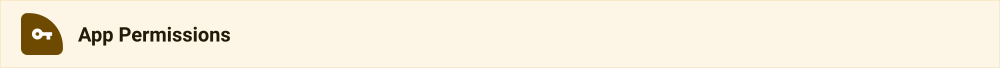
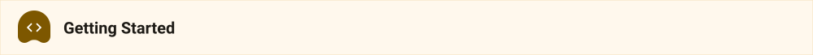

<div align="center">


# Photon Gallery

**An open-source, privacy-first Android gallery designed around performance and stunning visuals.**

<br/>

<p align="center">
  <a href="https://github.com/Bn5prS/Photon_Gallery/stargazers"><picture><source media="(prefers-color-scheme: dark)" srcset="assets/readme/dark/badge-stars.svg"></picture></a>
  <a href="https://github.com/Bn5prS/Photon_Gallery/releases"><picture><source media="(prefers-color-scheme: dark)" srcset="assets/readme/dark/badge-downloads.svg"></picture></a>
  <a href="https://github.com/Bn5prS/Photon_Gallery"><picture><source media="(prefers-color-scheme: dark)" srcset="assets/readme/dark/badge-views.svg"></picture></a>
  <a href="https://developer.android.com/about/versions/12"><picture><source media="(prefers-color-scheme: dark)" srcset="assets/readme/dark/badge-android.svg"></picture></a>
  <a href="https://kotlinlang.org"><picture><source media="(prefers-color-scheme: dark)" srcset="assets/readme/dark/badge-kotlin.svg"></picture></a>
  <a href="LICENSE"><picture><source media="(prefers-color-scheme: dark)" srcset="assets/readme/dark/badge-license.svg"></picture></a>
</p>

<p align="center">
  <picture><source media="(prefers-color-scheme: dark)" srcset="assets/readme/dark/badge-adfree.svg"></picture>
  <picture><source media="(prefers-color-scheme: dark)" srcset="assets/readme/dark/badge-m3e.svg"></picture>
  <picture><source media="(prefers-color-scheme: dark)" srcset="assets/readme/dark/badge-ai.svg"></picture>
  <a href="CONTRIBUTING.md"><picture><source media="(prefers-color-scheme: dark)" srcset="assets/readme/dark/badge-prs.svg"></picture></a>
</p>

<br/>

<a href="https://github.com/Bn5prS/Photon_Gallery/releases/latest">
  <picture>
    <source media="(prefers-color-scheme: dark)" srcset="assets/readme/dark/btn-download.svg">
    
  </picture>
</a>

<br/><br/>


</div>

---

<picture id="screenshots">
  <source media="(prefers-color-scheme: dark)" srcset="assets/readme/dark/h-screenshots.svg">
  
</picture>

<br/>

| Home | Albums | Viewer | Video |
|:---:|:---:|:---:|:---:|
|  |  |  |  |

| Multi-Select | Photo Editor | Stitch Tool | Settings |
|:---:|:---:|:---:|:---:|
|  |  |  |  |

---

<picture id="features">
  <source media="(prefers-color-scheme: dark)" srcset="assets/readme/dark/h-features.svg">
  
</picture>

<br/>

- **Fluid Media Browsing** — Responsive grid with smooth animations, customizable column layouts, and instant loading.
- **Material 3 Expressive UI** — Shape-morphing animations, spring physics, variable typography, and Material You dynamic theming.
- **Full-Screen Viewer & Video Player** — Pinch-to-zoom, background blur, EXIF inspector, and advanced video controls.
- **On-Device Smart Search & OCR** — Natural-language semantic search and on-device text recognition running 100% locally.
- **Photo Map & Places** — Geotagged media exploration on an interactive map with local caching.
- **Albums & Collections** — Smart auto-albums, custom pinning, folder exclusions, and custom album covers.
- **People & Face Grouping** — On-device facial recognition, automatic clustering, and smart merge suggestions running 100% locally.
- **Photo Editor & Markup Tools** — Drawing and annotations (pen, highlighter, neon brush, blur redaction, shapes, and interactive text), filters, color adjustments, and collage stitching.
- **Duplicate Cleaner & Recycle Bin** — Perceptual hash duplicate detection and soft-delete trash with auto-cleanup.
- **Private Space (Vault)** — Biometric-locked hidden vault isolated from the main gallery.

---

<picture id="privacy">
  <source media="(prefers-color-scheme: dark)" srcset="assets/readme/dark/h-privacy.svg">
  
</picture>

<br/>

Photon Gallery is built to be **local-first and private**. Your photos, videos, and albums never leave your device. There is **zero tracking, zero analytics, zero ads, and zero cloud uploads**.

Here is a clear breakdown of what runs on your phone versus what touches the internet:

### 100% On-Device (No Internet Needed)
- **Browsing & Indexing:** Loading photos, organizing albums, and reading file details all happen completely on-device.
- **Smart Search:** Search photos naturally by describing what is in them (e.g. "beach sunset"). Searches run locally on your device.
- **Face Grouping:** Automatically detects and groups similar faces purely on your phone.
- **Text in Photos (OCR):** Recognizes and lets you copy or search text inside images without sending pictures to any server.
- **Photo Editor & Markup:** Filters, drawing tools, blur, and photo stitching work entirely on your phone.
- **Duplicate Finder & Trash:** Helps you find duplicate pictures and clean up storage without an internet connection.

### Optional Internet Features
| Feature | Destination | Trigger | Purpose |
|---|---|---|---|
| **In-App Updates** | `api.github.com` | Periodic check / Manual tap in Settings | Checks for new app versions and changelogs. The update file is only downloaded if you choose to install it. |
| **On-Device AI Models** | `github.com` (Release assets) | First time using Smart Search or Face Grouping | Downloads the search and face grouping models once so they can run locally on your phone. Files are verified with checksums before saving. |
| **Photo Map** | `*.tile.openstreetmap.org` | Opening the Map tab | Loads map tiles from OpenStreetMap to show where photos were taken. Tiles are cached on your phone for faster reloading. |
| **Google Lens** | Installed Google Lens App | Tapping the Lens button in the viewer | Opens the selected picture in your device's Google Lens app. Photon Gallery makes no network requests itself. |
| **Place Names** | Android System Geocoder | Background indexing for geotagged photos | Converts GPS coordinates into city/country names using Android's built-in geocoder. |

---

<picture id="security">
  <source media="(prefers-color-scheme: dark)" srcset="assets/readme/dark/h-security.svg">
  
</picture>

<br/>

### Download Integrity
- **App Updates:** When updating via APK, Android checks that the update is signed with the developer's key. Any tampered or modified file will be rejected by Android.
- **AI Models:** Model files are checked against expected SHA-256 hashes during download. Incomplete or mismatched files are discarded immediately.

### Private Space (Vault)
- **Private Storage:** Hidden items are moved into the app's private folder and removed from Android's shared gallery list so other apps cannot see them.
- **Biometric & PIN Lock:** Access requires your fingerprint or your custom Master PIN.
- **Auto-Lock:** The vault automatically locks as soon as you exit or leave the app.

### Google ML Kit Note
- Face detection and text recognition use Google ML Kit. All processing runs directly on your device hardware, and no pictures or text are ever uploaded to Google.

---

<picture id="permissions">
  <source media="(prefers-color-scheme: dark)" srcset="assets/readme/dark/h-permissions.svg">
  
</picture>

<br/>

Photon Gallery only requests permissions needed to work as a complete gallery app:

| Permission | Category | Purpose |
|---|---|---|
| `READ_MEDIA_IMAGES` | Media | Read and display photos on Android 13+. |
| `READ_MEDIA_VIDEO` | Media | Play videos on Android 13+. |
| `READ_MEDIA_VISUAL_USER_SELECTED` | Media | Supports selected-photos-only access on Android 14+. |
| `READ_EXTERNAL_STORAGE` | Media | Read media on Android 12 and older. |
| `MANAGE_EXTERNAL_STORAGE` | File Management | Required for moving, renaming, deleting photos across albums/SD cards, and moving files into Private Space. |
| `INTERNET` | Network | Used only for map tiles, one-time model downloads, and update checks. |
| `ACCESS_NETWORK_STATE` | Network | Checks if internet is available before trying to download updates or models. |
| `REQUEST_INSTALL_PACKAGES` | Updater | Lets Android install a downloaded update when you confirm. |
| `POST_NOTIFICATIONS` | Notifications | Shows progress for indexing, model downloads, and update alerts on Android 13+. |
| `FOREGROUND_SERVICE` & `FOREGROUND_SERVICE_DATA_SYNC` | Background Work | Allows photo indexing (search, faces, text) to finish smoothly in the background. |
| `VIBRATE` | System | Provides subtle haptic feedback for buttons, editor tools, and the vault keypad. |
| `USE_BIOMETRIC` | Security | Allows fingerprint or face unlock for Private Space. |

---

<picture id="tech-stack">
  <source media="(prefers-color-scheme: dark)" srcset="assets/readme/dark/h-techstack.svg">
  
</picture>

<br/>

| Layer | Technology |
|---|---|
| **UI** | Jetpack Compose, Material 3 Expressive, Material Symbols icons, Google Sans Flex / Outfit & Urbanist |
| **Architecture** | MVVM, ViewModel, Room (SQLite + FTS5) |
| **Image Loading** | Coil 3 (GIF, WebP, HEIF, SVG, Video thumbnails) |
| **AI / ML** | ONNX Runtime (MobileCLIP, MobileFaceNet), Google ML Kit (Face Detection, Text Recognition OCR) |
| **Navigation** | Compose Navigation with Shared Element Transitions |
| **Maps** | osmdroid (OpenStreetMap with disk caching) |
| **Media** | Media3 / ExoPlayer |
| **Background** | WorkManager |
| **Min / Target SDK** | API 31 (Android 12) / API 37 |

---

<picture id="getting-started">
  <source media="(prefers-color-scheme: dark)" srcset="assets/readme/dark/h-getstarted.svg">
  
</picture>

<br/>

### Prerequisites
- Android Studio Meerkat or newer
- JDK 11+
- Android SDK with API 37

### Build & Deploy

```bash
# 1. Clone the repo
git clone https://github.com/Bn5prS/Photon_Gallery.git
cd Photon_Gallery

# 2. Verify the build compiles
./gradlew compileDebugKotlin

# 3. Assemble a signed release APK
./gradlew assembleRelease

# 4. Install on connected device
adb install -r app/build/outputs/apk/release/app-release.apk
```

> **Note:** A signing config is required for release builds. See Android's [signing documentation](https://developer.android.com/studio/publish/app-signing) to set one up.

---

<picture id="contributing">
  <source media="(prefers-color-scheme: dark)" srcset="assets/readme/dark/h-contributing.svg">
  
</picture>

<br/>

Contributions are warmly welcomed! Please see [CONTRIBUTING.md](CONTRIBUTING.md) for full guidelines on project architecture, code style, testing requirements, and pull request workflows.

Quick start:
1. **Fork** the repository
2. **Create a branch**: `git checkout -b feature/your-feature`
3. **Commit your changes**: `git commit -m "feat: add your feature"`
4. **Verify tests & lint**: `./gradlew lint testDebugUnitTest`
---

<picture id="license">
  <source media="(prefers-color-scheme: dark)" srcset="assets/readme/dark/h-license.svg">
  
</picture>

<br/>

Photon Gallery is licensed under the **GNU General Public License v3.0 (GPLv3)** with **Section 7 Additional Terms & Anti-Theft Provisions**:

- **Attribution & Legal Notices (Section 7b):** All copies, forks, modifications, and derivative works must conspicuously preserve original copyright notices, author attribution (`Bn5prS`), and repository links (`https://github.com/Bn5prS/Photon_Gallery`) in both source code and user-facing about/legal interfaces.
- **Prohibition of Origin Misrepresentation (Section 7c):** You must not misrepresent the origin of this software or claim authorship of the original code, UI design, or on-device AI algorithms. Any modified version or fork must be clearly marked as an unofficial fork.
- **Trademark & Branding Protection (Section 7e):** The name "Photon Gallery", project logo, branding, and package namespace (`com.inferno.gallery`) may not be used to endorse, brand, or promote derived works without prior written authorization. Forks must use distinct branding, icons, and package identifiers.
- **Re-Packaging & Commercial Store Restrictions:** Re-packaging this application with embedded advertisements, monetization trackers, or paid paywalls on app distribution platforms (including the Google Play Store, Amazon Appstore, GetApps, etc.) without significant functional contributions and explicit author authorization is strictly prohibited.

### What This Means for Users, Contributors, and Forks
- **For Users:** Photon Gallery is 100% free and open-source software (FOSS). You have complete freedom to use, study, inspect, and modify the application for personal use with zero tracking, paywalls, or ads.
- **For Contributors:** Contributions and pull requests are welcomed! All submitted code is licensed under the copyleft GPLv3 terms.
- **For Forks & Developers:** Legitimate open-source forks and experiments are encouraged under GPLv3. The additional terms strictly protect the project against bad-faith clones that strip author attributions or monetize the app with advertisements on app marketplaces.

See the [LICENSE](LICENSE) file for complete legal terms. Third-party font and icon licenses are documented in [LICENSES.md](LICENSES.md).

---

<div align="center">

Built with Kotlin & Jetpack Compose

[](https://github.com/Bn5prS/Photon_Gallery)

</div>
