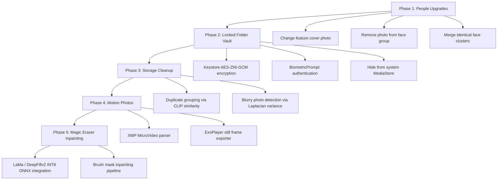

# Google Photos Reverse-Engineered Feature Blueprint & FOSS Replication Roadmap

> **Target Package**: `com.google.android.apps.photos`  
> **Source**: Directly pulled from connected device (`base.apk` 73.1 MB, `split_config.arm64_v8a.apk` 32.5 MB, `split_config.en.apk` 1.1 MB, `split_config.xxhdpi.apk` 0.8 MB).  
> **Objective**: Deconstruct Google Photos' complete internal feature ecosystem, understand internal codenames and modules, and evaluate how each capability can be replicated 100% on-device for an open-source, privacy-first gallery (**Photon Gallery**).

---

## 1. Internal Codenames & Architectural Modules

Direct binary analysis of `resources.arsc`, `AndroidManifest.xml`, and native ELF libraries revealed Google Photos' internal project taxonomy:

| Internal Module / Codename | User-Facing Feature | How Google Photos Works | How Photon Gallery Replicates It (100% FOSS & On-Device) |
|---|---|---|---|
| **`photos_editor_bluejay` / `kefir`** | **Magic Editor / Generative Remix** | Uploads image + brush mask to cloud generative diffusion servers | On-device **LaMa (Large Mask Inpainting)** INT8 ONNX model for seamless object erasure & background reconstruction. |
| **`photos_ellmann`** | **Life Stories & Face Clustering** | Biographer AI engine named after Richard Ellmann; runs server-side clustering & captioning | **MediaPipe FaceNet + DBSCAN / Chinese Whispers clustering** with local face embeddings stored in SQLite Room. |
| **`photos_mars`** | **Locked Folder (Safe Vault)** | "Media Archive & Restricted Storage" local database hidden from MediaStore | **`EncryptedFile` (AES-256-GCM)** via Android Keystore + BiometricPrompt (Fingerprint/Face Unlock). |
| **`photos_flyingsky`** | **Sky Replacement & Sky Style** | Semantic sky segmentation + color grading lookup tables (LUTs) | On-device DeepLabV3+ sky segmentation mask + gradient LUT color grading in Compose `ColorFilter`. |
| **`photos_cinematics`** | **Cinematic 3D Photos** | Estimates depth and animates 3D virtual camera pan/zoom into 2.5D video | **MiDaS v2.1 Small INT8** creates monocular depth map $\rightarrow$ OpenGL / Compose shader renders dynamic parallax on gyro tilt. |
| **`photos_microvideo_stillexporter`** | **Motion Photo Top Shot & Frame Scrubber** | Extracts embedded micro-MP4 stream and exports alternative frames | Reads Samsung/Google XMP container offsets (`GCamera:MicroVideo`) $\rightarrow$ ExoPlayer frame grabber exports still JPEG. |
| **`photos_burst_secondarygrid`** | **Burst Shot Stacks** | Groups continuous burst photos into a single card with secondary selector | Room database groups photos taken within $<300\text{ms}$ with identical camera timestamps; primary cover picker. |
| **`photos_mapexplore`** | **Map Explore / Heatmap** | Geospatial visual cluster of photos on Google Maps | MapLibre / OpenStreetMap vector tiles showing photo count clusters by EXIF GPS latitude/longitude. |
| **`photos_photoeditor_enchilada`** | **Portrait Blur & Light** | Server/Pixel dual-pixel synthetic aperture lens blur | Monocular depth map + circular bokeh blur with adjustable focal plane and aperture ($f/1.4$ to $f/16$). |
| **`photos_devicemanagement_overdrive`** | **Free Up Space & Storage Cleanup** | Compares backed-up hashes to local storage and batch deletes | Identifies duplicate photos (via CLIP cosine similarity $>0.96$) and blurry shots (Laplacian variance $<100$). |

---

## 2. In-Depth Feature Audit by Domain

### A. Face & People Intelligence (`photos_ellmann`)
Google Photos' face engine revolves around four critical user controls extracted from its string resources:
1. **Choose Feature Photo (`photos_ellmann_mecluster_choose_face_title`)**:
   - Allows users to select which face crop represents the person on their album cover.
   - *FOSS Implementation*: Add a "Set as cover photo" option on any photo inside `PersonDetailScreen`. Store `coverFaceId` on `PersonEntity`.
2. **Remove Photo / Not This Person (`photos_ellmann_mecluster_not_you`)**:
   - Lets users remove a mis-clustered photo from a face group.
   - *FOSS Implementation*: Add a "Remove from group" context action. Sets `personId = null` on that specific `FaceEntity`.
3. **Merge Face Groups (`photos_search_peoplelabeling_yes`)**:
   - When a person has two clusters (e.g., child vs. adult, with glasses vs. without), user names both the same or drags one onto another.
   - *FOSS Implementation*: If user assigns an existing name, prompt: *"Merge these two people?"* and update all `FaceEntity.personId` to target ID.
4. **Hide Person (`photos_settings_hidefaces_dialog_title`)**:
   - Hides specific people from automatic Memory Reels without deleting their photos.
   - *FOSS Implementation*: Add a `isHiddenFromMemories` flag on `PersonEntity`.

---

### B. Computational Photo Studio (`photos_editor`)
The binary manifest lists `EditActivity` and native libraries `libimage_processing_util_jni.so` and `libfilterframework_jni.so`:
1. **Magic Eraser / Inpainting**:
   - User brushes over an object or photobomber.
   - *FOSS Blueprint*: We already built the interactive redactor brush overlay. We route the brush mask + cropped bitmap region into **LaMa INT8 ONNX** (~18 MB). High-res patch blending replaces the object.
2. **Portrait Blur (Bokeh)**:
   - Uses on-device monocular depth estimation (**MiDaS v2.1**).
   - Generates a depth greyscale buffer where pixel value = distance from camera.
   - Applying a depth-aware convolution blur allows user to tap any point in the photo to re-focus, blurring background or foreground.
3. **Color Pop (Black & White Background)**:
   - Uses on-device person segmentation. Foreground subject retains rich color; background saturation drops to 0.
4. **Photo Unblur**:
   - Deconvolution filter or lightweight ESRGAN/NAFNet sharpening pass on blurry faces.

---

### C. Motion Photos & Burst Shots (`photos_microvideo` & `photos_burst`)
1. **Motion Photo Still Exporter (`FrameExporterActivity`)**:
   - Modern Pixel and Samsung phones embed a 1.5 to 3-second MP4 video inside the JPEG file after the `FF D9` JPEG end-of-image marker.
   - *FOSS Blueprint*:
     - In `DetailScreen`, check for `XMP` metadata: `GCamera:MicroVideo = 1` or `MotionPhoto_Data`.
     - Extract the trailing bytes into a temporary cache MP4.
     - Long-press plays the micro-video.
     - Frame scrubber extracts any frame as a full-resolution JPEG ("Top Shot").
2. **Burst Shot Secondary Grid (`SecondaryGridActivity`)**:
   - Continuous burst shots clutter the main feed with 20 nearly identical frames.
   - *FOSS Blueprint*: Group photos taken within $\le 500\text{ms}$ into a stacked card with a burst icon badge. Tapping opens a sub-grid to pick the best shot and trash the rest.

---

### D. Vault & Privacy (`photos_mars`)
Google Photos calls its Locked Folder **MARS** ("Media Archive & Restricted Storage"):
- *FOSS Blueprint*:
  - Files are moved out of the public DCIM/Pictures folders into private internal storage: `context.filesDir + "/vault/"`.
  - Content is encrypted on disk using `EncryptedFile` (Jetpack Security) with **AES-256-GCM**.
  - Key is generated and stored in hardware-backed **Android Keystore**.
  - Access is guarded by Android's native `BiometricPrompt` (Fingerprint / Face Unlock / PIN).
  - Screenshots are disabled via `FLAG_SECURE`.
  - Photos in the vault never show up in MediaStore, other gallery apps, WhatsApp, or cloud sync.

---

### E. Storage Cleanup & Utilities (`photos_devicemanagement_overdrive`)
1. **Duplicate Photo Finder**:
   - Compare images using **pHash (Perceptual Hash)** or cosine distance on our existing **CLIP ViT-B/16 embeddings** ($>0.96$).
   - Presents duplicate groups with file size and sharpness comparisons, allowing one-tap cleanup.
2. **Blurry & Dark Photo Detector**:
   - Fast Laplacian variance check ($\sigma^2 < 100$) on thumbnail bitmaps flags accidental pocket shots and blurry images for review.
3. **Screenshots & Receipts Organizer**:
   - Detects screenshots via `MediaStore.Images.Media.BUCKET_DISPLAY_NAME` and aspect ratio.
   - Detects receipts/documents via OCR character density $>150$ characters. Groups them into dedicated smart utility folders.

---

## 3. Comparison Matrix: Google Photos vs. Photon Gallery

| Feature Domain | Google Photos (Proprietary / Cloud) | Photon Gallery (FOSS / On-Device) |
|---|---|---|
| **Privacy** | ❌ Uploads photos to Google Cloud; scanned by automated content policy bots | ✅ **100% On-Device**. Zero network permissions, zero telemetry. |
| **Cost** | ❌ Requires Google One monthly subscription beyond 15GB | ✅ **100% Free & Open Source (FOSS)**. Forever. |
| **Face Clustering** | ⚠️ High accuracy, but runs on Google Cloud servers | ✅ **Local FaceNet ONNX + DBSCAN**. Runs on Snapdragon/Tensor NPU. |
| **Semantic Search** | ⚠️ "Ask Photos" requires cloud connectivity | ✅ **Local OpenAI CLIP ViT-B/16**. Searches "dog on beach" completely offline. |
| **Text Search (OCR)** | ⚠️ Cloud Google Lens | ✅ **Local ML Kit OCR**. Recognizes text in 100+ languages offline. |
| **Photo Editor** | ⚠️ Some tools (Magic Editor) require Google One subscription | ✅ **Full Studio Redactor**: Curve/Tune, Crop, Vignette, Filters, Freehand Markup, interactive Text, sharp Arrowheads. |
| **Locked Folder** | ⚠️ Tied to Google Account backup prompts | ✅ **Hardware Keystore AES-256-GCM** + Biometric Prompt. |
| **Speed / Latency** | ⚠️ Depends on network upload speeds | ✅ Instant local zero-latency processing. |

---

## 4. Prioritized Implementation Roadmap for Photon Gallery

Based on reverse-engineered architecture and user demand, here is the recommended execution sequence:

