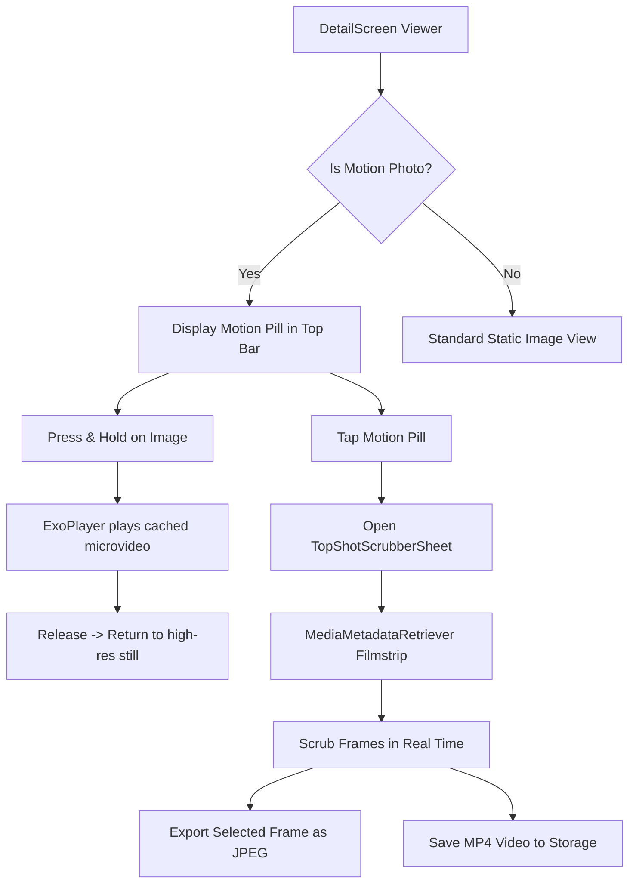

# Motion Photos & Top Shot Frame Exporter — Design Specification

**Feature**: Motion Photo Player & Top Shot Frame Scrubber  
**Author**: Michalych647  
**Date**: 2026-10-24  
**Status**: DRAFT FOR APPROVAL  

---

## 1. Intent & Problem Statement

Modern smartphone cameras (Google Pixel, Samsung Galaxy, Xiaomi, and OnePlus) capture **Motion Photos** (also known as Live Photos / Micro-Videos). When shutter is pressed, the camera captures a high-resolution still image while embedding a 1.5 to 3-second MP4 video clip directly into the same JPEG file.

Currently, Photon Gallery treats these files as standard static images:
- The embedded video stream is ignored.
- Users cannot see the micro-motion before or after the shot.
- Users cannot scrub through the video frames to pick a better shot when someone blinked or looked away (**Top Shot**).

This feature adds native on-device **Motion Photo Playback** (Google Photos / iOS Live Photos style) and an interactive **Top Shot Frame Scrubber** to Photon Gallery.

---

## 2. Goals, Non-Goals & Anti-Goals

### Goals
- **Universal Container Detection**: Support both Google Camera (`GCamera:MicroVideo` / `GCamera:MotionPhoto`) and Samsung (`MotionPhoto_Data`) formats, with a universal MP4 `ftyp` trailer fallback parser.
- **Fast Zero-Lag Extraction**: Read byte offsets directly via seekable file streams and cache the extracted `.mp4` into `cacheDir/motion_videos/` without duplicating the original photo.
- **Natural Press-to-Play UX**:
  - Motion photos display a Material 3 `[Motion]` pill with `ic_ms_motion_photos_on` in the top bar.
  - Press-and-hold anywhere on the photo seamlessly plays the micro-video with a haptic tick; releasing returns to the crisp original photo.
- **Top Shot Keyframe Scrubber**:
  - Tapping the `[Motion]` pill opens a Material 3 `ModalBottomSheet` filmstrip.
  - Interactive slider scrubs through video frames with real-time preview.
  - Visual pin marking the camera's original still capture timestamp.
  - One-tap **"Export as Photo"** saves the selected frame as a full JPEG into `Pictures/Photon Gallery` with MediaStore indexing.
  - One-tap **"Save as Video"** exports the micro-video as a standalone MP4 file.
- **100% Offline & Private**: Zero network permissions; all parsing and playback runs locally on-device.

### Non-Goals
- Modifying or stripping the motion video from the original JPEG file (the original file is never mutated).
- Motion photo capture (Photon Gallery is a gallery/viewer, not a camera app).

### Anti-Goals
- Heavy FFmpeg binaries or cloud transcoding. Playback must utilize Android's built-in `ExoPlayer` / `MediaMetadataRetriever`.

---

## 3. Architecture & File Format Specs

```
┌────────────────────────────────────────────────────────────────────────┐
│               MOTION PHOTO JPEG DUAL-PAYLOAD CONTAINER                 │
├────────────────────────────────────────┬───────────────────────────────┤
│ 1. Standard JPEG Image Payload         │ 2. Embedded MP4 Video Stream  │
│ [FF D8 ... Exif/XMP ... FF D9 (EOF)]   │ [00 00 00 18 ftypmp42 ...]    │
│ Standard Android MediaStore & Gallery  │ Extracted on-demand for Motion│
└────────────────────────────────────────┴───────────────────────────────┘
```

### Detection Logic (`MotionPhotoParser.kt`)
1. **Google XMP Check**:
   - Look for `GCamera:MotionPhoto="1"`, `GCamera:MicroVideo="1"`, or `Item:Mime="video/mp4"`.
   - Read `GCamera:MicroVideoOffset` (bytes from end of file).
2. **Samsung Marker Check**:
   - Search the last 128KB of the file for the string `MotionPhoto_Data`.
   - Read the 4-byte big-endian integer immediately following, indicating video length in bytes.
3. **Universal MP4 Atom Fallback**:
   - Scan backward from EOF for the 8-byte signature `....ftyp` (box type `ftypmp42`, `ftypisom`, `ftypqt`).
   - The byte offset of `ftyp - 4` is the exact start of the MP4 stream.

---

## 4. Component Architecture



### 1. `MotionPhotoParser.kt`
- Input: `Context`, `Uri`.
- Methods:
  - `fun detectMotionPhoto(context: Context, uri: Uri): MotionPhotoInfo?`
  - `suspend fun extractMotionVideo(context: Context, uri: Uri, mediaId: Long): File?`
- Cache strategy: Saved to `context.cacheDir/motion_cache/{mediaId}.mp4`. Checked before parsing.

### 2. `DetailScreen.kt` Integration
- When a photo opens in `DetailScreen`:
  - `LaunchedEffect(currentMedia.id)` calls `MotionPhotoParser.detectMotionPhoto`.
  - If detected, `isMotionPhoto = true`.
- Top bar displays `MotionPill`:
  - Icon: `ic_ms_motion_photos_on`
  - Label: "Motion"
- Gesture detection:
  - Detects `pointerInput` press / long-press.
  - While pressed: hides image layer, displays looping video surface with `MotionTokens.snappySpring()`.
  - On release: cross-fades back to photo.

### 3. `TopShotScrubberSheet.kt`
- Bottom sheet rendering:
  - Header with close button, title "Top Shot", and frame timestamp.
  - Large live frame preview.
  - Horizontal filmstrip with 16-24 thumbnail frames extracted via `MediaMetadataRetriever.getFrameAtTime`.
  - Visual badge on the frame corresponding to the original still photo.
  - Actions row:
    - **Export as Photo** (saves full-res frame to MediaStore).
    - **Save as Video** (saves `.mp4` to `Movies/Photon Gallery`).

---

## 5. Material 3 Expressive Compliance (AGENTS.md)
- **Colors**: Colors resolved through `MaterialTheme.colorScheme` (`primaryContainer`, `surfaceContainerHigh`, `surfaceContainerHighest`). Zero raw hex.
- **Shapes**: `ShapeEdgeTop` for modal bottom sheet, `ShapeFull` for pills and buttons, `ShapeMedium` for filmstrip frame thumbnails.
- **Typography**: Google Fonts Outfit for titles, Plus Jakarta Sans for labels/actions.
- **Motion**: `MotionTokens.snappySpring()` and `MotionTokens.gentleSpring()` for player cross-fade and sheet entry/exit.
- **Icons**: Strictly `ic_ms_motion_photos_on`, `ic_ms_save`, `ic_ms_movie`, `ic_ms_close`.

---

## 6. Verification Plan
1. **Unit Tests**:
   - `MotionPhotoParserTest.kt`: Test parsing on simulated Google MicroVideo and Samsung byte structures, verifying offset calculation and non-motion rejection.
2. **Device Verification**:
   - Run release build on connected device `10BEAK2JR50012G`.
   - Open a camera photo taken with motion photos enabled.
   - Verify:
     - Motion pill displays in top bar.
     - Press and hold plays video smoothly.
     - Tapping motion pill opens Top Shot scrubber sheet with filmstrip.
     - Scrubbing updates frame preview.
     - "Export as Photo" saves a clean new JPEG.
